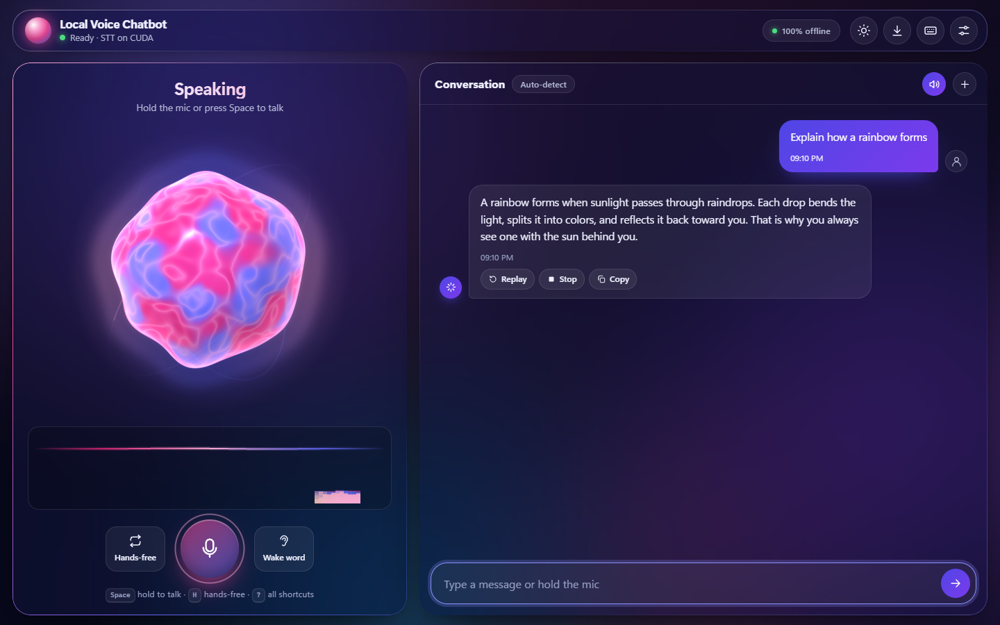
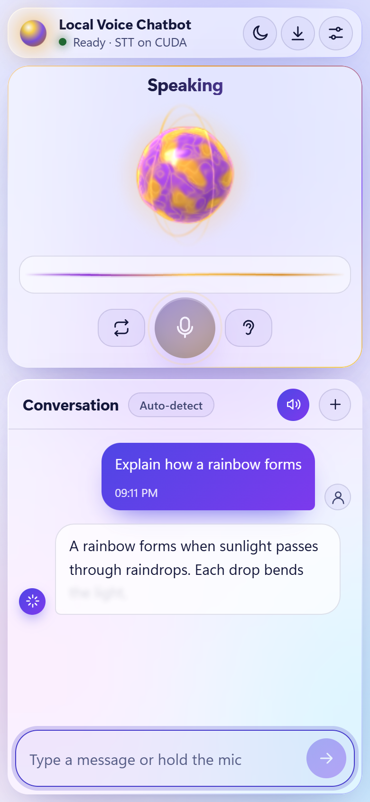
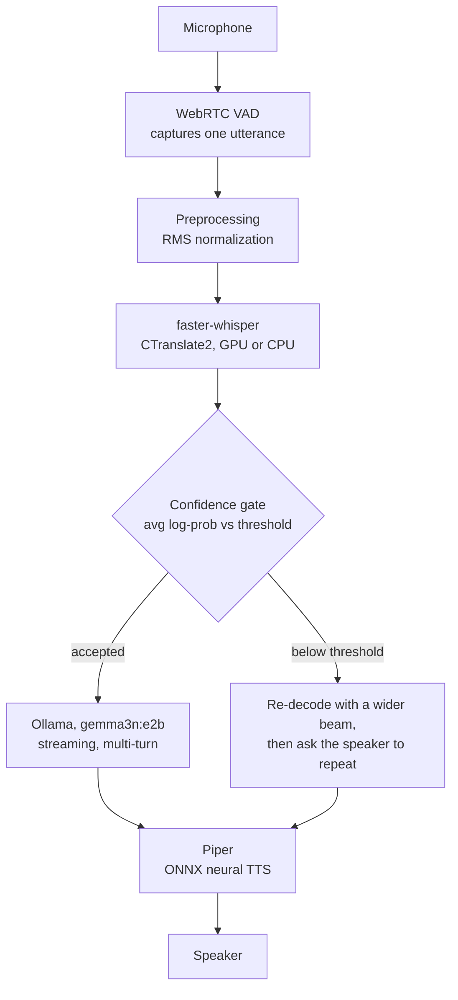
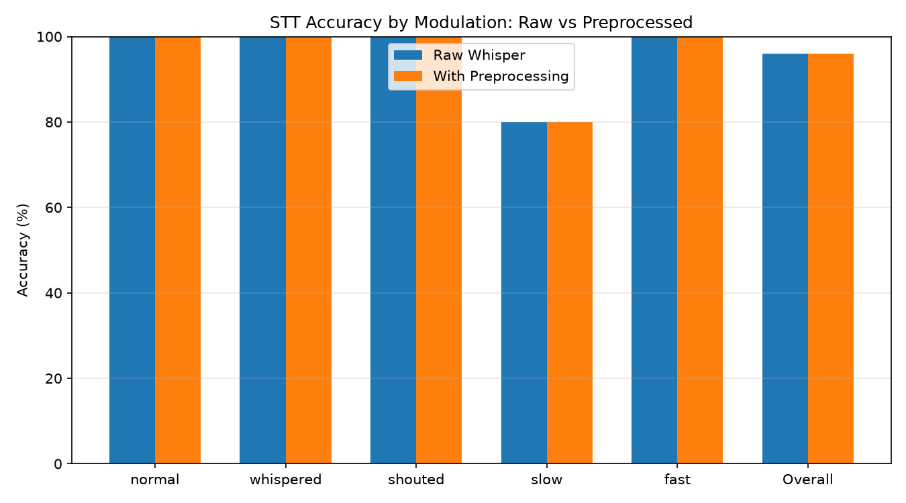

# Local Voice Chatbot

A speech-to-text, LLM, text-to-speech assistant that runs entirely on the local
machine. No cloud APIs, no network calls at inference time. In front of Whisper
the pipeline adds a preprocessing and confidence-gating layer, so speech
delivered under unusual modulation (whispered, shouted, fast, slow, or
off-pitch) is either transcribed reliably or explicitly rejected, rather than
passed downstream as a confident mistranscription.

[](https://github.com/Sandeepsrinivasan-14/voice-chatbot/actions/workflows/tests.yml)


<p align="center">
  
</p>
<p align="center">
  
</p>

## Background

Whisper and comparable STT models are trained mostly on clean, conversational
speech. Under strong modulation the input drifts away from that distribution, and
the model tends to fail by producing a fluent but wrong transcription rather than
by signaling uncertainty. A confident-looking wrong transcription is the worst
case for a voice agent: it feeds bad input to the LLM, and the user gets a
plausible answer to a question they never asked.

Two mechanisms address this:

- **RMS normalization** rescales the loudness of the incoming audio to a fixed
  target before decoding, so a whisper and a shout reach Whisper at a comparable
  level.
- **Confidence gating** reads the average token log-probability from the decode.
  Below a configurable threshold the utterance is re-decoded with a wider beam.
  If it still fails, the assistant asks the speaker to repeat instead of
  continuing.

## How it works



Every stage runs on local CPU or GPU. The only process boundary is a loopback
HTTP call to Ollama on `localhost:11434`.

## Stack

| Stage | Choice | Why |
| :--- | :--- | :--- |
| STT | faster-whisper | CTranslate2 build of Whisper. Runs on CPU with no extra packages, and uses roughly a quarter of the VRAM of the reference implementation at similar accuracy, which is what lets it sit next to the LLM on a 4 GB GPU. |
| LLM | Ollama running `gemma3n:e2b` | Handles GGUF quantization and GPU offload with no extra setup. One model for English/Hindi/Tamil (see "Multilingual support" below for why) at ~1.7GB VRAM. |
| TTS | Piper | Small ONNX voice model. Synthesizes faster than real time on CPU. |
| DSP | librosa | RMS measurement, pitch tracking, and onset detection in the preprocessing stage. |

## The modulation-robustness layer

### Preprocessing, [`src/preprocessing.py`](src/preprocessing.py)

- RMS/volume normalization on every utterance (`TARGET_RMS = 0.1`).
- Pitch and tempo outlier detection: fundamental-frequency and onset-density
  tracking. Detection and logging only. The correction step is off by default
  (`ENABLE_PITCH_CORRECTION = ENABLE_SPEED_CORRECTION = False`); see
  [Benchmark](#benchmark) for why.

### Confidence gate, [`src/confidence_check.py`](src/confidence_check.py)

- `evaluate()` maps an average log-probability to one of three decisions:
  `ACCEPTED`, `RETRY_MORE_BEAMS`, or `ASK_TO_REPEAT`.
- The threshold defaults to `-0.6` (`CONFIDENCE_THRESHOLD`). The score is not a
  calibrated probability and its distribution shifts with speaker and microphone,
  so re-tune it against your own `logs/confidence_log.csv`.
- Every decision is appended to that CSV with the transcription, the score, the
  beam size used, and the attempt number.

### Response shaping, [`src/pipeline.py`](src/pipeline.py)

The system prompt holds the LLM to one to three plain sentences, with no Markdown
tables, lists, or symbols that a TTS engine would read aloud awkwardly.

## Multilingual support (Hindi & Tamil)

`WHISPER_LANGUAGE=auto` (the default) lets faster-whisper detect the spoken
language per utterance -- English, Hindi, or Tamil -- instead of forcing
English. The browser UI has a language selector (top right) to force a
language instead of relying on detection, useful on a short/ambiguous clip.

- **STT**: no new model needed -- faster-whisper's multilingual checkpoint
  already covers Hindi and Tamil. Accuracy is expected to be somewhat lower
  than English (Whisper was trained on far less Hindi/Tamil audio, Tamil
  more so than Hindi); `medium` or larger is recommended over the repo
  default `small` for non-English use.
- **LLM**: the system prompt instructs the model to reply in the same
  language it was addressed in. Live testing (real requests against a
  running server, not a formal benchmark) went through several
  general-purpose models (`llama3.2:3b`, `qwen2.5:3b/7b-instruct`) that
  were reliably fluent in English and Hindi but inconsistent-to-garbled
  in Tamil regardless of size -- Tamil is simply underrepresented in
  their training data. That led to an earlier dual-model setup (a
  Tamil-specialized Llama-2 fine-tune routed only for Tamil, since it
  broke on Hindi), which worked but meant Ollama couldn't keep both
  models resident on a 4GB GPU at once -- a language switch mid-
  conversation paid a ~20-25s model-reload penalty. `gemma3n:e2b` (an
  Ollama model, ~1.7GB VRAM) replaced that setup after live testing found
  it the only one of everything tried that was coherent in all three
  languages -- see `OLLAMA_MODEL` in `.env.example`. No manual
  `ollama pull` needed: `chat_web.py` pulls it itself in the background
  on first startup. A `OLLAMA_MODEL_TA` escape hatch still exists in
  `config.py` (empty by default, meaning "no override") in case a future
  language needs the same per-language routing gemma3n:e2b made
  unnecessary -- see `src/chat_web.py`'s `get_ollama_model_for_language()`.
- **TTS**: English and Hindi both go through Piper (`en_US-lessac-medium`,
  `hi_IN-pratham-medium`, both in `models/piper/`) -- same small local
  binary, just a different voice file per language. **Piper ships no Tamil
  voice at all.** Tamil speech instead goes through a separate engine,
  [`src/indic_tts.py`](src/indic_tts.py) -- AI4Bharat's FastPitch+HiFiGAN
  checkpoint (their "Indic-TTS" project), run through coqui-tts's
  `Synthesizer` -- on by default (`TAMIL_TTS_ENABLED=1`). No manual setup
  step is needed: `indic_tts.py` installs `requirements-indic-tts.txt`
  and downloads the ~1.5GB checkpoint itself the first time Tamil speech
  is actually requested (`chat_web.py` also kicks both off proactively in
  the background at startup, so they're usually already done by the time
  a real request needs them). Set `TAMIL_TTS_ENABLED=0` to opt out
  entirely on a deployment that only ever needs English/Hindi.
- **Why Tamil TTS switched engines**: this project originally used
  AI4Bharat's `indic-parler-tts` (a large autoregressive transformer),
  which needed a CUDA GPU to be usably fast (~20-25s per short reply even
  on GPU; multiple minutes on CPU) and shared this project's small 4GB
  dev GPU with Whisper STT -- a real, live-caught GPU-lock contention bug
  where any Tamil TTS call froze every other in-flight request (any
  language) for its full duration. Live comparison against AI4Bharat's
  FastPitch+HiFiGAN checkpoint found it both faster (~1.5-2s per sentence
  on CPU alone, no GPU needed at all) and more accurate (round-tripping
  synthesized audio back through Whisper STT came back near-perfect, vs.
  genuine word-level errors for indic-parler-tts on the same sentences) --
  FastPitch and HiFiGAN are both small, non-autoregressive models, the
  same architecture family as Piper, which is why Piper was already fast.
  Switching resolved the GPU-lock contention as a side effect: Tamil TTS
  no longer touches the GPU, so there's nothing left to contend with
  Whisper over. `MAX_SPEECH_CHARS_TA` in `src/pipeline.py` still caps how
  much of one chunk gets spoken (180 chars, vs. 280 for Piper) as a safety
  net against a pathological run-on sentence -- see that module's comment
  for details, and its `truncate_for_speech()` for how the cut always
  lands on a sentence boundary.
- A genuine bug caught while building this: Piper's own console-script
  subprocess decoded stdin using Windows' system codepage instead of UTF-8
  unless the parent process happened to already have `PYTHONIOENCODING` set
  -- silently corrupting any non-ASCII text (Devanagari, Tamil script; this
  never surfaced with English). Fixed at the time by explicitly setting
  `PYTHONIOENCODING`/`PYTHONUTF8` on the Piper subprocess's own
  environment; later removed entirely (not just made moot) when Piper
  moved from a subprocess-per-call to a cached in-process `PiperVoice`
  (see `synthesize_speech()`) -- no subprocess means no codepage to get
  wrong in the first place.

Verified end-to-end on this machine: real Hindi text synthesized by Piper,
fed back through faster-whisper, came back auto-detected as `hi` with a
near-exact transcript; the same round-trip through the current Tamil TTS
engine (AI4Bharat FastPitch+HiFiGAN, see "Multilingual support" above) came
back near-perfect too. `gemma3n:e2b` produces fluent, on-topic replies in
English, Hindi, and Tamil in live testing. Not yet run as a byte-for-byte
accuracy benchmark the way English STT was (see below) -- that's the
natural next step before calling this production-ready.

## Continuous learning (STT correction feedback)

Off by default (`LEARNING_ENABLED=0`). When off, `/api/transcribe`'s
response is exactly what it was before this feature existed. This is the
foundation phase of a larger plan: capture corrections reliably first, learn
from them safely second, only later use them to improve the base model
itself. See [`src/learning/`](src/learning) for the code.

Turn it on with `LEARNING_ENABLED=1` in `.env` (see `.env.example` for every
sub-flag). Four independent switches, all effective only while the master
flag is on:

- `LEARNING_FEEDBACK_ENABLED`: lets the browser UI submit corrections.
- `LEARNING_PERSONALIZED_CORRECTION_ENABLED`: looks up a profile's own past
  corrections at transcribe time.
- `LEARNING_CONTEXT_AWARE_ENABLED`: scores candidate corrections against the
  current sentence instead of just the phrase.
- `LEARNING_AUTO_APPLY_ENABLED`: separate from the three above, and off by
  default even when they're all on. This is the one flag that rewrites what
  gets sent to the LLM without the user confirming it first.

### How a correction is captured

Voice-transcribed messages in the browser UI get a small "Correct" button.
Editing and saving posts to `POST /api/feedback`, which writes one row to a
SQLite database (`data/learning/feedback.db`, gitignored) via
[`src/learning/feedback_store.py`](src/learning/feedback_store.py). That
table is append-only by database contract, not just convention: a trigger
rejects any `UPDATE` or `DELETE` against it, so no code path, buggy or not,
can lose or alter a correction once it's recorded. Original and corrected
text are stored as separate fields; a word-level diff
([`src/learning/diffing.py`](src/learning/diffing.py), stdlib `difflib`) is
computed at write time, so "I went to Chennai with John" becoming "...with
Jon" is stored as a single `replace("John", "Jon")`, not "the sentence
changed."

### How a correction is used

[`src/learning/correction_memory.py`](src/learning/correction_memory.py)
derives a separate, rebuildable table of per-profile correction rules
(phrase pairs with a frequency and a recency) from the feedback log. It
never writes to the feedback log, so `correction_rules` can be deleted and
rebuilt at any time without losing history.
[`src/learning/correction_engine.py`](src/learning/correction_engine.py)
runs at transcribe time: for each of *this profile's* rules that matches a
whole word span in the new transcript, it scores the match (exact/fuzzy
phrase similarity, context word overlap, frequency, recency, STT confidence,
all deterministic, see
[`src/learning/correction_scoring.py`](src/learning/correction_scoring.py);
no embeddings, no vector search, no LLM call) and returns one of three
outcomes: below `LEARNING_SUGGEST_THRESHOLD` the original is kept; above it
the correction is surfaced as a suggestion; above
`LEARNING_AUTO_APPLY_THRESHOLD` (and only with `LEARNING_AUTO_APPLY_ENABLED`
and `LEARNING_CONTEXT_AWARE_ENABLED` both on) it's applied automatically,
with the untouched raw STT text still returned alongside it.

A rule like `"four" -> "for"` cannot become a blanket find-and-replace: if
the current sentence shares no words with the context the rule was learned
in, the match is dropped outright rather than merely scored low. Rules are
also strictly scoped per profile, a lightweight, no-auth local id generated
by the browser and stored in `localStorage` (see
[`src/learning/profiles.py`](src/learning/profiles.py); not real
authentication, appropriate for a single-machine offline app). One profile's
corrections can never affect another's.

### Audio persistence

Also off by default (`LEARNING_PERSIST_AUDIO_ENABLED=0`), independent of
every flag above. STT fine-tuning needs (audio, corrected transcript)
pairs, not text alone, so this exists specifically to feed that. When on,
the processed audio for an accepted transcription is held in memory only
(never written to disk) via
[`src/learning/audio_cache.py`](src/learning/audio_cache.py); it's written
to `LEARNING_AUDIO_DIR` (`data/learning/audio/`, gitignored) only at the
moment a correction is actually submitted for that specific transcription.
Audio for the transcriptions nobody corrects, which is most of them, is
never written anywhere.

### Building a training dataset

[`src/learning/dataset_builder.py`](src/learning/dataset_builder.py) turns
accumulated feedback events into a versioned, reproducible dataset:

```python
from learning import dataset_builder

manifest = dataset_builder.build_dataset("data/learning/feedback.db", "data/learning/datasets")
```

It selects events that have a corrected transcript, a real audio file on
disk above a minimum size, the target language, and aren't a near-duplicate
of another selected event; everything else is counted and reported, not
silently dropped. Output is `data/learning/datasets/v<N>/manifest.csv` (a
deterministic 85/15 train/eval split, hashed from each event's id so
re-running the builder on the same data reproduces the same split) plus
`dataset.json` with the selection counts and a content hash.

### Fine-tuning (LoRA/PEFT)

[`src/learning/training.py`](src/learning/training.py) fine-tunes the base
Whisper model with LoRA ([`peft`](https://github.com/huggingface/peft),
targeting the attention projection layers) on a dataset's train split,
merges the adapter, and converts the result to CTranslate2 with
`ct2-transformers-converter` (already installed; it ships with the
`ctranslate2` package in `requirements.txt`) so it's a drop-in replacement
for the stock model faster-whisper loads. It needs `torch`, `transformers`,
and `peft`, deliberately kept out of every other requirements file -- see
[`requirements-training.txt`](requirements-training.txt) -- so installing
them is opt-in and `chat_web.py` never depends on them. Run it as:

```bash
pip install -r requirements-training.txt   # multi-GB download; do this once
python -m learning.training --dataset-version v1
```

It always evaluates the candidate against the current production model on
the held-out ("eval") split first
([`src/learning/evaluation.py`](src/learning/evaluation.py): plain word
error rate, no new dependency) and prints the comparison; it never promotes
automatically. Promotion additionally requires both `--promote` on the
command line *and* the evaluation actually recommending it (a meaningful
relative WER improvement with no single held-out example regressing badly)
-- see
[`src/learning/model_registry.py`](src/learning/model_registry.py), which
tracks every trained version, which one is in production, and supports
`rollback()` to the previous one.

**No fine-tuning has been run in this repository.** The infrastructure
above is complete and tested (dataset building, WER evaluation, and the
registry's promotion/rollback logic all have unit tests that don't need
torch installed at all), but running it for real needs real
(audio, corrected-transcript) pairs, and `data/learning/feedback.db` is
currently empty -- this feature only just shipped, disabled by default.
Fabricating placeholder examples to produce a "trained" model would be
exactly the kind of superficial result this project's own benchmark
history argues against (see [Benchmark](#benchmark)). The path to a real
first fine-tune is: turn on `LEARNING_ENABLED=1` and
`LEARNING_PERSIST_AUDIO_ENABLED=1`, use the app normally, correct
transcripts as they come up, then build a dataset and run the command
above once enough examples exist.

### Not yet implemented

- Personalized-memory scoring more sophisticated than the deterministic
  baseline in [How a correction is used](#how-a-correction-is-used).
- A held-out human validation workflow that sets a feedback event's
  `validation_status` (the dataset builder already reads that field and
  excludes `"rejected"`; nothing writes anything but the default
  `"unvalidated"` yet).
- Wiring this into `src/cli.py`: the terminal interface reimplements its
  own loop independently of `chat_web.py` and isn't touched by this phase.
- An actually-deployed fine-tuned model: see above.

## Benchmark

The set is 25 recordings: five command words (`yes`, `no`, `stop`, `help`,
`start`), each spoken five ways (normal, whispered, shouted, slow, fast), by one
speaker on one microphone. Each clip is transcribed twice, raw and through the
preprocessing layer, and scored against the expected word.

| Modulation | Raw | With preprocessing |
| :--- | :---: | :---: |
| Normal | 5 / 5 | 5 / 5 |
| Whispered | 5 / 5 | 5 / 5 |
| Shouted | 5 / 5 | 5 / 5 |
| Slow | 4 / 5 | 4 / 5 |
| Fast | 5 / 5 | 5 / 5 |
| **Total** | **24 / 25 (96%)** | **24 / 25 (96%)** |



Raw data: [`data/results/benchmark_results.csv`](data/results/benchmark_results.csv).
Reproduce with `python src/benchmark.py`.

On this set RMS normalization holds accuracy level. It neither helps nor hurts,
because Whisper already handles these five words well once they are loud enough.
The one persistent error (`help` spoken slowly, transcribed as `"L"`) is not a
loudness problem, and normalization does not fix it.

An earlier version of the layer also pitch-shifted and time-stretched outliers.
On these single-word clips that dropped the overall score to 48%: onset density is
a poor tempo estimate for a clip containing a single word, so the "correction"
was warping audio that was already fine. Pitch and speed correction were switched
off by default; detection and logging still run. A regression test pins the 96%
parity so it cannot silently come back.

## Setup

Requires Python 3.11 or 3.12 and a running [Ollama](https://ollama.com/) install.

```bash
git clone https://github.com/Sandeepsrinivasan-14/voice-chatbot.git
cd voice-chatbot

python -m venv venv
source venv/bin/activate            # Windows: .\venv\Scripts\activate

pip install -r requirements.txt         # CPU
# pip install -r requirements-gpu.txt   # GPU: CUDA 12.x, ~1.3 GB of wheels
```

`requirements.txt` uses lower-bound pins; Dependabot proposes bumps weekly and CI
verifies them. To capture an exact environment for your own machine, run
`pip freeze > my-lock.txt` after installing.

English and Hindi need no extra Python packages, but the Piper voice files
(`.onnx` + `.onnx.json`) are large binaries that are **not** committed: download
them into `models/piper/` first -- see [`models/piper/README.md`](models/piper/README.md)
for the exact files and links. Tamil TTS is on by default and needs a separate, heavier
engine -- see [Multilingual support](#multilingual-support-hindi--tamil) --
but nothing to install by hand: `src/indic_tts.py` runs

```bash
pip install -r requirements-indic-tts.txt
```

itself, automatically, the first time Tamil speech is actually requested
(set `TAMIL_TTS_ENABLED=0` to opt out and skip this entirely). If you'd
rather pre-install it yourself ahead of time (e.g. to avoid that first-use
delay), the same command works fine to run manually too.

Pull the model:

```bash
ollama pull gemma3n:e2b
```

Check the install. Reports on CUDA, faster-whisper, Ollama, and Piper:

```bash
python verify_setup.py
```

<details>
<summary>Sample output (GPU machine, all components present)</summary>

```
============================================================
Local Voice Chatbot -- setup verification
============================================================

[1/4] Checking CUDA availability for faster-whisper (CTranslate2)...
  PASS -- 1 CUDA device(s) visible to CTranslate2.

[2/4] Loading faster-whisper and transcribing a synthetic test clip...
  PASS -- model loaded and ran inference on cuda.

[3/4] Checking Ollama server + a test generation...
  Ollama is running. Installed models: ['gemma3n:e2b']
  Cold-starting 'gemma3n:e2b' (first load can take a while)...
  PASS -- 'gemma3n:e2b' responded: "What's on your mind?"

[4/4] Checking Piper TTS synthesis...
  PASS -- wrote logs\_verify_piper_test.wav (128556 bytes).

============================================================
Summary
============================================================
  CUDA             PASS
  faster-whisper   PASS
  Ollama           PASS
  Piper            PASS

All critical components OK. Ready for src/cli.py.
```

</details>

Every tunable has a default in [`src/config.py`](src/config.py). To override one,
copy `.env.example` to `.env` and edit it. Nothing in `.env` is required to run.

## Running it

### Browser UI

```bash
python src/chat_web.py       # then open http://localhost:5006
```

The server binds to `127.0.0.1` only (`WEB_HOST`). To serve it through Waitress
instead of Flask's development server:

```powershell
$env:PRODUCTION = 1; python src/chat_web.py
```

The interface is plain HTML, CSS and ES modules under [`src/web_chat/`](src/web_chat/) --
no build step, no bundler, no CDN and no vendored third-party library, so it
works with the network unplugged:

- **Voice stage.** A WebGL orb (a single fragment shader, lazy-loaded after
  first paint) that reacts to the live microphone level while you talk and to
  the actual audio being played while the assistant speaks, with a distinct
  look for idle, listening, thinking and speaking. If WebGL is unavailable a
  CSS orb takes over. A live waveform and scrolling spectrogram sit below it.
- **Glass conversation panel.** Streaming message bubbles, per-message
  Replay / Stop / Copy, confidence under voice messages, and the inline
  transcript-correction form when continuous learning is on.
- **Push-to-talk and tap-to-talk.** Hold the mic button (or `Space`) and release
  to send; a quick tap instead records until you pause or tap again.
- **Settings drawer.** Language (auto, English, Hindi, Tamil), spoken replies
  on/off, speaking speed and volume, microphone sensitivity, pause length,
  theme (system / dark / light), motion (auto / reduced / full) and whether to
  show confidence scores. Saved in the browser's `localStorage`.
- **Transcript export** as Markdown, plain text or JSON, or copy to clipboard.
  Built in the browser; nothing is uploaded.
- **Accessibility.** The transcript is an `aria-live` log (held back while a
  reply streams, so a screen reader reads the finished reply once), state
  changes are announced, every control is keyboard-reachable with visible
  focus, text meets WCAG AA contrast in both themes, and `prefers-reduced-motion`
  (or the motion setting) stops the background drift, ripples and orb animation.
- **Responsive.** Two columns on desktop, a compact stacked layout on phones.

Keyboard shortcuts (press `?` in the app for the list): `Space` hold to talk,
`M` start/stop recording, `H` hands-free, `W` wake word, `V` spoken replies,
`Esc` stop speaking or cancel recording, `/` focus the message box, `N` new
conversation, `E` export, `S` settings, `T` theme.

#### Conversational controls

Everything below runs in the browser against the same backend API; each one
degrades independently (turning one off never breaks another):

- **Auto-stop on silence.** Recording stops on its own roughly 0.8s after you
  stop talking (a simple RMS-energy check via the Web Audio API with an
  adaptive noise floor, not a webrtcvad port -- see
  [`recorder.js`](src/web_chat/js/recorder.js) for why). The pause length and
  sensitivity are in the settings drawer.
- **Barge-in.** Pressing the mic or sending a message cuts the assistant's
  current speech off immediately, and cancels the in-flight reply and
  speech-synthesis requests so an interrupted answer stops using the GPU.
- **Hands-free mode.** After each reply finishes speaking, the mic reopens
  automatically -- no tapping between turns. Off by default.
- **Wake word.** Say "hey chatbot" to start listening from idle, like "Hey
  Siri" -- implemented by reusing the local Whisper model already running (no
  third-party wake-word engine, no account/API key, fully offline), so
  background speech gets a brief local transcription check and is discarded
  unless it matches. Off by default; turning it on requests microphone access
  immediately.

None of these require the continuous-learning layer below -- they work
identically whether `LEARNING_ENABLED` is on or off.

### Terminal

```bash
python src/cli.py
```

Voice activity detection drives capture. Speak, then pause.

### Docker (CPU, browser UI)

```bash
docker build -t voice-chatbot .
docker run --rm -p 127.0.0.1:5006:5006   -e OLLAMA_URL=http://host.docker.internal:11434   -v "$PWD/models:/app/models" -v whisper-cache:/home/app/.cache   voice-chatbot
```

Then open <http://localhost:5006>. The container needs no audio hardware (the
browser records and plays audio). Ollama is not bundled; point `OLLAMA_URL` at
the one on your host (on Linux add `--add-host=host.docker.internal:host-gateway`).
Always publish the port to `127.0.0.1` -- the app has no authentication; see
[SECURITY.md](SECURITY.md). GPU inference is not supported in the image.

## Tests and code quality

```bash
pip install -r requirements-dev.txt
ruff check .     # lint
mypy             # type check src/
pytest           # ~220 tests; the GPU, Ollama, and the microphone are all mocked
```

CI ([`.github/workflows/tests.yml`](.github/workflows/tests.yml)) runs lint and
type checking, then the suite on Python 3.11 and 3.12 (Ubuntu) plus 3.11 on
Windows, and verifies that the Docker image builds and serves `/api/health`.
The front-end logic tests (`tests/test_frontend_logic.py`) use Node when it is installed and skip otherwise. Tests that need a GPU, large models, or real services are marked `gpu`, `slow`
or `integration`; `gpu` tests skip themselves when no CUDA device is present.
`pre-commit install` runs lint and type checks locally before each commit. See
[CONTRIBUTING.md](CONTRIBUTING.md) and [docs/REQUIREMENTS.md](docs/REQUIREMENTS.md)
(what each `requirements-*.txt` is for).

## Troubleshooting

| Symptom | Cause and fix |
| :--- | :--- |
| `Could not reach Ollama at http://localhost:11434. Is \`ollama serve\` running?` | Start Ollama and `ollama pull gemma3n:e2b`. Using Docker or a remote host? Set `OLLAMA_URL`. |
| `OSError: PortAudio library not found` (Linux) | `sudo apt-get install libportaudio2`. `sounddevice` loads it at import, even for the browser UI. |
| Piper fails to load a voice / no speech | The voice `.onnx` + `.onnx.json` files are not in `models/piper/`. See [`models/piper/README.md`](models/piper/README.md), or set `PIPER_MODEL_PATH`. |
| Whisper runs on CPU although you have an NVIDIA GPU | Install `requirements-gpu.txt`. On Windows `src/cuda_dlls.py` must run before `faster_whisper` is imported (entry points already do this). `python verify_setup.py` reports what was found. |
| Browser mic prompt never appears | Browsers only allow microphone capture on `localhost`/HTTPS. Use `http://localhost:5006`, not a LAN IP. |
| First Tamil reply is slow or triggers a big install | Tamil TTS auto-installs `requirements-indic-tts.txt` (~1 GB) on first use. Pre-install it, or set `TAMIL_TTS_ENABLED=0`. |
| Port already in use | Change `CHAT_WEB_PORT` / `RECORD_WEB_PORT` in `.env`. |
| Reachable from other machines? | It should not be: `WEB_HOST` defaults to `127.0.0.1` and there is no authentication. |
| Anything else | Run `python verify_setup.py`, then check `logs/` (rotating files). |

## Windows and CUDA

On Windows, CTranslate2 resolves its CUDA DLLs (`cublas64_12.dll`,
`cudnn64_9.dll`) through `LoadLibrary`, which ignores `os.add_dll_directory()`.
[`src/cuda_dlls.py`](src/cuda_dlls.py) prepends the `nvidia-cublas-cu12` and
`nvidia-cudnn-cu12` wheel directories to `PATH` before `faster_whisper` is
imported, so GPU inference works without a system-wide CUDA install. It has to be
imported first; the entry-point scripts already do that.

## Scope

Included: centralized configuration, the mocked test suite and CI, a Waitress
server option, rotating file logs, JSON error responses with a 25 MB upload cap
on the web endpoints, and retry-with-backoff on the Ollama client.

Left out by choice: authentication, multi-user support, GPU containers, and
packaging (a CPU Docker image for the browser UI is provided). This is a single-user application meant to run on the machine in front
of you. The continuous-learning layer's profile id is a matching lightweight,
no-auth abstraction, not a step toward real multi-tenancy; see
[Continuous learning](#continuous-learning-stt-correction-feedback).

`src/cli.py` is intentionally not wired into the continuous-learning layer: it
reimplements its own capture-to-speech loop independently of `chat_web.py`
rather than sharing it, and extending it adds risk for no benefit yet.

## Project layout

```
src/
  pipeline.py          orchestration: capture, GPU/CPU fallback, streaming LLM, TTS playback
  preprocessing.py     RMS normalization; pitch/speed detection
  confidence_check.py  log-probability gate and CSV audit log
  config.py            frozen Config dataclass, .env support
  cuda_dlls.py         Windows CUDA DLL path fix
  chat_web.py          browser chat UI server (web_chat/: index.html, css/, js/ ES modules)
  record_web.py        dataset recorder UI server (web_recorder/)
  web_common.py        shared Flask setup: JSON errors, static files, CSP and security headers
  browser_audio.py     decodes browser MediaRecorder audio (webm/ogg) to float32 PCM via PyAV
  cli.py               terminal interface with live VAD
  benchmark.py         raw-vs-preprocessed accuracy benchmark
  indic_tts.py          Tamil TTS via AI4Bharat FastPitch+HiFiGAN (needs requirements-indic-tts.txt)
  learning/            continuous-learning STT correction feedback (off by default)
    feedback_store.py    immutable feedback events (SQLite, UPDATE/DELETE blocked by triggers)
    diffing.py            word-level diff between original and corrected transcripts
    correction_memory.py  derived, rebuildable per-profile correction rules
    correction_scoring.py pure scoring primitives (no ML, no embeddings)
    correction_engine.py  keep / suggest / auto-apply decision, run at transcribe time
    profiles.py            local no-auth profile/session id resolution
    audio_cache.py          in-memory bridge to opt-in audio persistence
    dataset_builder.py       builds versioned training datasets from feedback
    evaluation.py             WER computation, baseline-vs-candidate comparison
    model_registry.py          trained-model versioning, promotion gating, rollback
    training.py                 LoRA/PEFT fine-tuning entry point (needs requirements-training.txt)
tests/                 ~220 pytest tests, fully mocked (incl. front-end asset/CSP checks)
docs/                  specification (PDF + HTML sources) and REQUIREMENTS.md
Dockerfile             CPU image for the browser UI
.github/               CI workflow (lint, mypy, test matrix, docker) and Dependabot
pyproject.toml         pytest, ruff, and mypy configuration
requirements*.txt      split dependency sets, explained in docs/REQUIREMENTS.md
SECURITY.md, CONTRIBUTING.md
```

## Documentation

A full functional and technical specification is in
[`docs/Local_Voice_Chatbot_Technical_Documentation.pdf`](docs/Local_Voice_Chatbot_Technical_Documentation.pdf),
built from the HTML sources in `docs/` with `python docs/build_pdf.py`.

## License

MIT. See [LICENSE](LICENSE).
